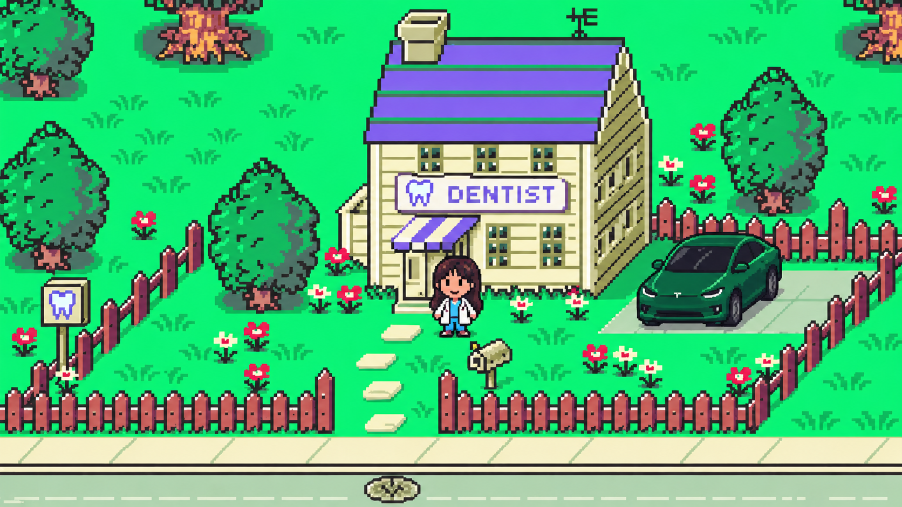

# Molar Quest — Mother-Inspired Graphic and Game-Type Spec

**Status:** Art and gameplay direction baseline  
**Scope:** Translate the design language of Nintendo's *Mother* / *EarthBound* series into an original identity for *Molar Quest*. This is not a request to reproduce Nintendo characters, locations, dialogue, music, sprites, or UI assets.

## 0. Hard visual reference

**Reference asset:** [`docs/visual-references/molar-quest-hard-visual-reference.png`](docs/visual-references/molar-quest-hard-visual-reference.png)  
**Asset dimensions:** 1672×941 px  
**Asset SHA-256:** `8b68927cf3577b247bd34e942ce659f130c28ae9c7fae3b4009f24652127f612`

This image is the **hard visual reference** for all overworld art, exterior locations, characters shown at world scale, props, foliage, vehicles, paths, fences, and streets. It is an art-direction target, not a source of written instructions and not an asset sheet to trace.

Its 1672×941 presentation is reference framing only. It does not override the game's 480×288 internal playfield, responsive layout, UI rules, or accessibility requirements.

### Reference priority

When visual guidance conflicts, use this order:

1. Accessibility, gameplay readability, and original-IP requirements in this spec.
2. The hard visual reference above.
3. The detailed graphic rules in section 5.
4. General *Mother* / *EarthBound* research and other mood references.

The image therefore overrides a looser interpretation of “retro pixel art.” New visuals should belong to the same coherent world at first glance.

### Non-negotiable visual traits

- **View:** elevated three-quarter/top-down view. Ground reads from above while buildings and props show their front and right/left side planes.
- **Pixel character:** deliberately chunky pixel clusters with crisp stair-stepped diagonals, no anti-aliasing, no vector-smooth contours, and no painterly texture.
- **Color:** extremely bright emerald grass, warm cream architecture and paving, violet branding/roof accents, coral-red fences and flowers, and near-black blue-gray outlines.
- **Value structure:** sunlit and high-key overall, anchored by dark outlines and cool cast shadows. Objects remain readable through both silhouette and value.
- **Architecture:** simplified small-town buildings with readable siding bands, roof planes, window grids, projecting awnings, oversized signs, and clear entrances.
- **Character scale:** compact chibi figure with an oversized head, short limbs, large hair silhouette, and a recognizable light clinic coat at world scale.
- **Foliage:** rounded, clustered canopies with dark outer contours, two or three internal green values, sparse highlight pixels, visible trunks, and flat offset ground shadows.
- **Props:** recognizable real-world silhouettes simplified into pixel clusters. Mailboxes, signs, fences, cars, flowers, and utility details give the location specificity.
- **Depth:** created by overlap, side planes, cast shadows, fence occlusion, and scale—not blur, atmospheric haze, or realistic perspective.
- **Composition:** one clear hero building or activity per scene, framed by landscaping; paths create a direct readable route to the entrance.
- **Density:** generous open grass around detailed landmarks. Avoid filling every tile with noise.

### Drift that is not allowed

- Do not shift to flat orthographic tiles with buildings shown only from the front.
- Do not use soft vector art, HD illustration, painterly backgrounds, isometric 3D, low-poly rendering, or realistic photography.
- Do not mute the scene into a brown, gray, or desaturated “vintage” palette.
- Do not replace the heavy dark contour language with outline-free sprites.
- Do not make characters realistically proportioned at world scale.
- Do not use tiny low-detail buildings that lack visible roof and side planes.
- Do not trace the reference building, character, car, foliage, or layout pixel-for-pixel. Produce original assets using the same visual grammar.

### Visual review gate

Every new exterior scene should be reviewed side-by-side with this image at comparable display size. It passes only if all of the following are true:

- palette intensity and warm/cool balance feel related;
- outline weight and pixel density feel related;
- building depth and readable signage feel related;
- character proportions and rendering detail feel related;
- foliage clustering and shadow treatment feel related;
- the scene remains original rather than a rearrangement of the reference.

## 1. Research conclusion

The *Mother* series is a **single-player Japanese role-playing game (JRPG)** series. Its recognizable form is:

- top-down, four-direction exploration;
- 2D tile-based cartoon pixel art;
- ordinary modern places instead of medieval-fantasy worlds;
- funny, conversational NPC writing mixed with sincere and sometimes unsettling story beats;
- menu-driven, turn-based encounters using normal objects and psychic abilities;
- simple-looking systems with one memorable twist, such as EarthBound's rolling HP or Mother 3's rhythm attacks;
- a strong contrast between a friendly overworld and abstract or psychedelic battle presentation.

Nintendo describes *EarthBound* as an RPG built around exploring towns, shopping, gathering companions, solving problems, and fighting with weapons and psychic powers. It also confirms the gradually decreasing HP display and automatic victories over enemies that are far weaker than the party. Nintendo's official *Mother 3* material confirms visible field encounters, positional advantages when an enemy is approached from behind, rhythm-timed combo attacks, character-specific abilities, PSI, and rolling HP.

The defining quality is therefore not merely “retro pixel art.” It is the combination of **the everyday, the absurd, and the heartfelt**, expressed through a readable, toy-like graphic style and approachable RPG systems.

## 2. Entry-by-entry reference

| Entry | Graphic type | Exploration and encounter type | Distinguishing feature |
|---|---|---|---|
| *Mother* / *EarthBound Beginnings* (1989, Famicom/NES) | 8-bit, top-down tiled overworld; small flat-color sprites; first-person battle images | Four-direction town/world exploration; random, menu-driven turn-based battles | Dragon Quest-style foundation moved into a quirky late-20th-century American setting |
| *Mother 2* / *EarthBound* (1994, Super Famicom/SNES) | 16-bit cartoon pixel art; oblique top-down towns; bold silhouettes; large enemy portraits over animated psychedelic battle backgrounds | Visible field enemies; contact initiates first-person menu battles | Rolling HP, instant wins over weak enemies, modern objects and food as equipment/items |
| *Mother 3* (2006, Game Boy Advance) | Refined 2D handheld pixel art; more expressive animation; similar cartoon proportions | Visible field enemies; front/back contact changes battle advantage; turn-based menus | Rhythm-based attack combos, rolling HP, chapter-based storytelling and changing protagonists |

Historical display references are approximately 256×240 for the Famicom/NES title, 256×224 for the Super Famicom/SNES title, and 240×160 for the Game Boy Advance title. These are reference-era rasters, not required output sizes for this web game.

## 3. Project game type

### Product label

**Single-player top-down narrative RPG with life-sim-lite scheduling and clinical sequencing puzzles.**

### Player fantasy

Be a new neighborhood dentist whose careful work visibly improves the town and earns its trust.

### Design pillars

1. **Ordinary place, memorable people** — the clinic, café, lab, stores, streets, and home should feel familiar; individual residents make them special.
2. **Funny and sincere can coexist** — light jokes and odd details sit beside honest patient worries without making pain the joke.
3. **Simple inputs, meaningful follow-through** — walking, talking, selecting tools, and advancing the day are easy; treatment order and lab timing create decisions.
4. **The world remembers** — treated patients reappear in town, lab cases progress, dialogue changes, and Pearl District becomes visibly livelier.
5. **Clinical, never graphic** — treatment is communicated through icons, diagrams, reactions, and abstract effects rather than blood, needles entering tissue, or realistic surgery.

### Audience and play shape

- Players: 1
- Input: keyboard, touch controls, or gamepad-style directional and confirm/cancel actions
- Camera: fixed top-down/oblique 2D; no rotation and no perspective zoom during play
- Main-story MVP: six authored patient cases across multiple clinic days
- Typical case: 2–4 minutes, excluding exploration
- Failure: recoverable and encouraging; a failed procedure resets the case, never the full day
- Saving target: at the start/end of a clinic day and after lab collection

## 4. Core game loop

1. Open the clinic and read the day's appointment list.
2. Walk through Pearl District to meet a patient.
3. Listen to the patient's concern and inspect Claire's note.
4. Complete a treatment by selecting tools in the correct clinical order.
5. Receive XP/reputation and, when required, a final impression.
6. Walk to Pearl Dental Lab, choose the correct restoration, and submit the case.
7. End the clinic day; active lab orders advance by one production day.
8. Collect completed work, deliver it, and see recovered patients return to town life.

### Mother-to-Molar Quest translation

| Mother-series convention | Molar Quest interpretation |
|---|---|
| Explore a humorous modern town | Walk through a compact dental neighborhood with eccentric but grounded residents |
| Talk to almost everyone | Give each patient/shopkeeper concise optional dialogue and at least one post-treatment line |
| Turn-based command selection | Select the next clinical tool from a menu; order matters more than speed |
| HP/PP tension | Steadiness hearts and a generous procedure timer show recoverable pressure |
| Party growth and equipment | Claire gains XP, clinic rank, tool access, and restoration options |
| Quest-state changes | Patients recover, lab orders advance, storefront/town activity changes |
| Psychedelic battle abstraction | Use patterned color motion and symbolic tooth diagrams during treatment |
| Humorous enemies/items | Use playful case descriptions, instrument icons, cats, and town details—without trivializing patients |

Do **not** add conventional combat merely to imitate *Mother*. The clinical sequencing puzzle already fills the encounter role and better supports this game's subject.

## 5. Graphic specification

### 5.1 Rendering baseline

- Internal world canvas: **480×288 px**.
- World grid: **30×18 tiles**.
- Base tile: **16×16 px**.
- Scaling: integer multiples whenever space permits; CSS must use `image-rendering: pixelated`.
- Canvas drawing: `imageSmoothingEnabled = false`.
- Movement: one 16 px tile per input in the MVP; four cardinal directions only.
- Camera: show the full compact district in the MVP. If the map grows, follow Claire in whole-pixel increments and never subpixel-scroll.
- Aspect ratio: **5:3** for the playfield. On narrow screens, letterbox or recompose UI; do not distort pixels.

### 5.2 Pixel-art language

- Shapes are chunky, geometric, and immediately readable at native size.
- Match the hard reference's apparent pixel density: major silhouettes use large stepped contours while interior material details use smaller clustered marks. Do not mix multiple incompatible pixel grids within the same object.
- Use flat color areas and clusters of pixels; do not use airbrush shading, texture noise, anti-aliased edges, or realistic material rendering.
- Use a very dark blue-gray (`#222D35`) for outlines instead of absolute black.
- Use one base color, one or two shadows, and optionally one highlight per material; the hard reference's trees, siding, roof, and car show the maximum intended material depth.
- Shadows are hard-edged and offset 1–3 px. No soft drop shadows inside the game canvas.
- Important interactables must be recognizable by silhouette before color.
- Decorative detail must not compete with doors, patients, the lab, or the player character.

### 5.3 Character sprites

- Target standing sprite: approximately **16×24 logical px**, occupying one 16 px collision tile while hair, head, and feet may extend beyond it. The existing 16×18 MVP figure is a placeholder and should gain the reference image's clearer head, hair, coat, hands, and shoe separation during the art pass.
- Proportion: oversized head, compact torso, very short legs; friendly “toy person” silhouette.
- Face at world scale: two eye pixels are enough; reserve detailed expressions for portraits.
- Minimum MVP animation: idle plus a two-frame walking/bobbing cycle.
- Preferred production animation: three frames per direction (contact, passing, contact), four directions.
- Claire must read at a glance through a light clinic coat and cyan accent; each patient gets one unique high-chroma clothing color.
- NPC diversity should come from silhouette, hair, clothing, mobility aids, age, and posture—not palette swaps alone.

### 5.4 Environment art

- Architecture: simplified storefront fronts with visible signs, windows, roof bands, entrances, and a visible side wall/roof plane whenever space permits.
- Perspective: elevated three-quarter ground and building presentation matching the hard reference; consistency is more important than physical accuracy.
- Paths should be broad, pale, and visually calmer than grass.
- Use small repeatable landmarks—flowers, fences, trees, lamps, signs—to make routes memorable.
- Every important destination needs both a shape cue and a text/sign cue. Color alone is insufficient.
- The clinic, lab, café, store, apothecary, and Claire's home each require a distinct roof/sign color and silhouette.

### 5.5 Palette

The existing bright handheld palette is the baseline:

| Role | Color |
|---|---|
| Ink / outline | `#222D35` |
| Deep panel | `#26323A` |
| Paper | `#FFFDE6` |
| Cream path | `#FFF8CA` |
| Field green | `#07E66E` |
| Dark field green | `#02B95C` |
| Violet action / brand | `#7457E6` |
| Coral warning / character accent | `#FF526F` |
| Gold reward / focus | `#FFE260` |
| Cyan clinical accent | `#56BDE0` |

Rules:

- Keep a single scene to roughly **24–40 simultaneous colors**.
- Reserve violet for primary actions/brand, gold for rewards/current focus, and coral for caution/error.
- Maintain at least 4.5:1 contrast for normal HTML text. Pixel-art labels should also have a dark backing panel or outline.
- Treatment screens may shift into mint/cyan and animated pattern colors, but the tooth diagram stays cream, brown, coral, and dark ink.

### 5.6 Treatment presentation

- Transition from the friendly town into an abstract, high-contrast procedure screen.
- Show a symbolic tooth/case diagram, not a realistic mouth.
- Tool choices appear as large bordered command tiles with icon plus label.
- Correct actions create a short flash, pulse, or rhythmic color change; incorrect actions shake the panel and remove one steadiness heart.
- Motion should use stepped timing. Honor `prefers-reduced-motion` by removing shakes, spins, and background animation.
- Keep all progress information visible at once: patient, diagnosis, current step, completed steps, steadiness, and time.

### 5.7 UI style

- Rectangular cream panels with **2–4 px dark borders** and **2–6 px hard offset shadows**.
- Labels: uppercase monospace, 7–10 px at internal scale, generous tracking.
- Dialogue/body copy: 11–13 px equivalent at display size; never render essential HTML copy into the canvas.
- One obvious primary action per panel.
- Dialogue portrait + name + one short quote + clinical note + action.
- Avoid overly elaborate fantasy ornaments. UI should feel like a playful handheld computer, clinic form, and 1990s RPG window combined.
- Never reuse *EarthBound* window patterns, exact layouts, fonts, icons, or wording.

## 6. Writing and tone specification

- Dialogue is short, conversational, and specific to the speaker.
- Favor mundane observations with one surprising turn over strings of random jokes.
- Each main case needs: concern, reassurance, procedure context, recovery line, and one town follow-up line.
- Humor targets inconvenience, personality, pets, bureaucracy, or odd objects—not fear, disability, hygiene, appearance, or pain.
- Emotional scenes use plain language. Do not undercut every sincere beat with a joke.
- The recommended tonal mix is approximately **60% warm/earnest, 25% playful, 15% strange or mysterious**.
- The cats act as a home-life chorus and emotional reset; they never enter treatment space.

## 7. Audio direction

- Use original chiptune-inspired music, not melodies or sound effects from *Mother*.
- Town: strong singable melody, playful bass, light percussion, 90–120 BPM.
- Clinic/treatment: more pulse and syncopation, 105–135 BPM, without creating panic.
- Home: sparse toy-piano or soft square-wave arrangement.
- Feedback sounds are short and tonal: move, confirm, correct step, mistake, reward, and lab completion each require a distinct pitch contour.
- If rhythm input is later added, it should improve treatment quality or rewards; it must remain optional for accessibility.

## 8. Acceptance criteria

### Visual

- [ ] The town is legible when the 480×288 canvas is shown at native size.
- [ ] Every pixel-art edge remains crisp at 1×, 2×, and 3× scaling.
- [ ] Claire, active patients, the clinic, and the lab can be identified without reading the minimap.
- [ ] No canvas sprite uses anti-aliasing, smooth gradients, or subpixel placement.
- [ ] Interactive and status colors are understandable with color-vision simulation or from shape/text alone.
- [ ] Treatment imagery remains diagrammatic and non-graphic.

### Gameplay

- [ ] A new player can move and interact without reading external instructions.
- [ ] The current patient and next available action are always apparent.
- [ ] A wrong tool gives immediate visual/audio feedback and permits recovery.
- [ ] Lab orders visibly show patient, product, status, and days remaining.
- [ ] Ending a day advances every working order exactly once.
- [ ] A treated patient returns to the town and has changed follow-up dialogue.
- [ ] Completing a case updates at least two forms of state: personal progression and world/town state.
- [ ] The six authored cases can be completed without grinding.

### Tone and originality

- [ ] Art is recognizably inspired by the same retro design era but contains no traced/copied Nintendo assets.
- [ ] No character, location, item, enemy, phrase, melody, or screen is a near-copy of *Mother* / *EarthBound*.
- [ ] Patient dignity is preserved in failure, humor, and recovery text.

## 9. Source notes

- [Nintendo — EarthBound product page](https://www.nintendo.com/en-gb/Games/Super-Nintendo/EarthBound-771110.html): official genre, exploration, shopping, combat, rolling HP, and instant-win descriptions.
- [Nintendo — official EarthBound Player's Guide (PDF)](https://www.nintendo.co.jp/clvs/manuals/common/pdf/CLV-P-SAAJE.pdf): original controls, menus, characters, battles, items, and visual presentation.
- [Nintendo — Mother 3 world guide](https://www.nintendo.co.jp/n08/a3uj/now_walk/index.html): official field contact, back attacks, sound battles, PSI, recovery, shopping, and rolling-HP explanation.
- [Nintendo — Mother 3 manual (PDF, Japanese)](https://www.nintendo.co.jp/data/software/manual/manual_pc9j_00.pdf): official system reference for battle menus, sound battles, and HP behavior.
- [Nintendo — Mother 3 official site](https://www.nintendo.co.jp/n08/a3uj/index.html): official RPG classification and release information.
- [Mother series overview](https://en.wikipedia.org/wiki/Mother_%28video_game_series%29): cross-entry release, development, setting, and reception overview; used as a secondary source and checked against Nintendo's primary material above.
